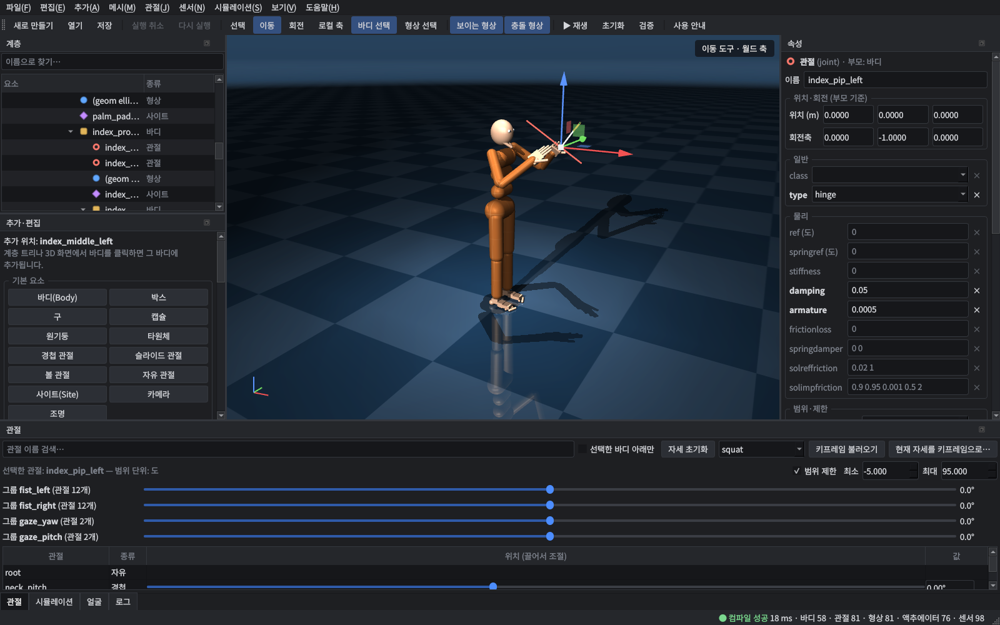
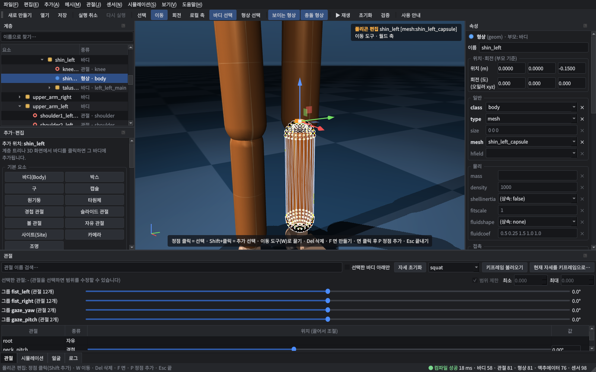
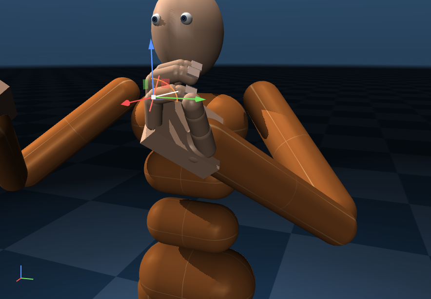
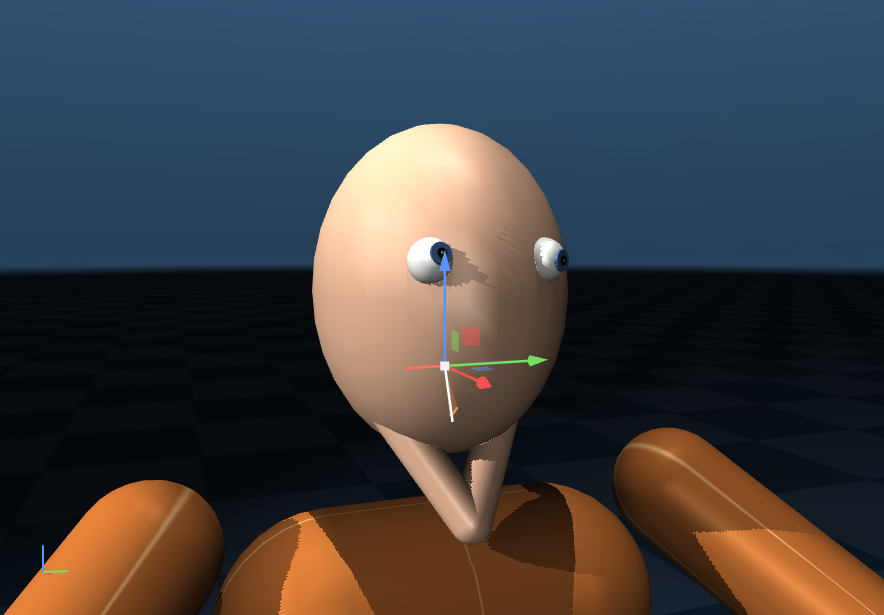
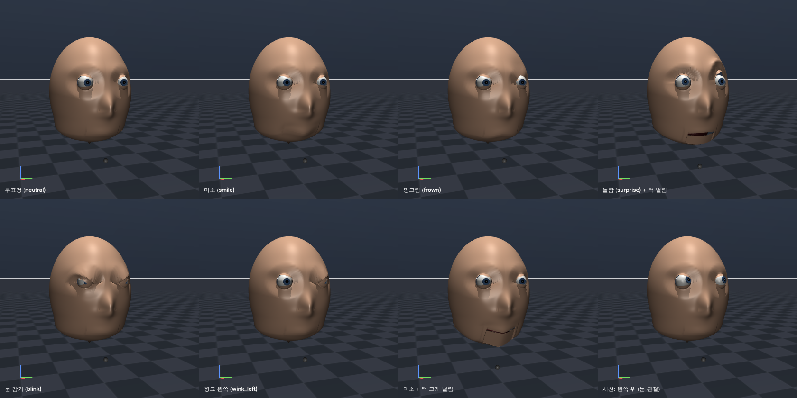
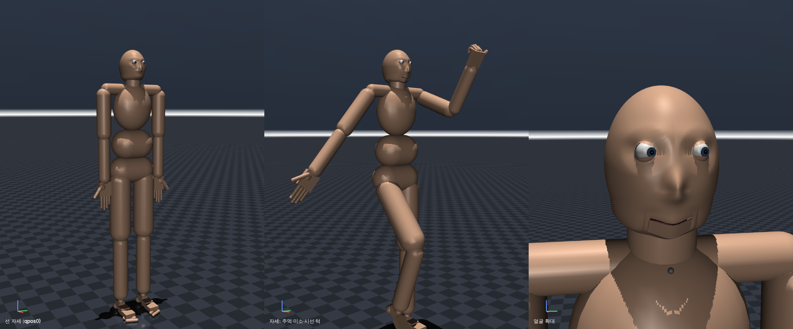
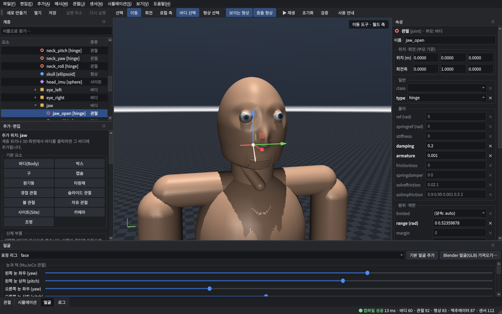

# MuJoCo Model Studio

MuJoCo 물리 시뮬레이션용 **시각적 모델 편집·조립 프로그램**입니다. 기존 MJCF를 불러와 계층/속성/관절을
편집하고, 부품(손·발·머리 등)을 독립 파일로 만들어 다른 모델에 조립하며, MuJoCo로 즉시 검증·시뮬레이션합니다.
인간형(AGI 연구용 신체)이 주 목적이지만 편집기 자체는 로봇·동물·기계 등 범용입니다.



## 무엇을 어디서 하나요? (빠른 안내)

화면은 모두 한국어입니다. 모델에 무언가를 **더하거나 고치는 기능은 왼쪽 아래 `추가·편집` 패널**에 모여 있고,
같은 기능이 메뉴(`추가`, `메시`)와 3D 화면의 **오른쪽 클릭 메뉴**에도 있습니다. 프로그램 안에서는 `도움말 › 사용 안내`(F1).

| 하고 싶은 일 | 위치 |
|---|---|
| 어디에 붙일지 정하기 | 계층 트리나 3D 화면에서 **바디를 클릭** → 패널 맨 위에 `추가 위치: (바디 이름)` 표시 |
| **손가락 하나 추가** | 손바닥 바디 선택 → `추가·편집 › 신체 부품 › 손가락 하나…` → 검지·중지·약지·소지·엄지, 좌/우, 붙일 위치(기본값 자동), 크기 |
| 손 전체·발·머리·전신 | `추가·편집 › 신체 부품` (또는 메뉴 `추가 › 신체 부품`) |
| **내가 만든 3D 모델 붙이기** | 바디 선택 → `추가·편집 › 내 3D 모델 › 3D 모델 파일 붙이기 (OBJ·STL·GLB)…` → 단위(mm 등), 좌표축(Blender 등), 선택한 바디에 붙이기/새 바디, 충돌 형상(볼록 껍질·박스·캡슐…) 선택 |
| **폴리곤(정점·면) 수정** | 형상 선택(도구막대 `형상 선택`이 편리) → `폴리곤 편집 시작 / 끝내기`(Tab). 캡슐·박스 같은 기본 형상이면 **편집 가능한 메시로 변환할지 묻습니다**. 정점 클릭(Shift 추가) → 이동 도구(W)로 끌기, Del 삭제, F 세 정점으로 면, 면 클릭 후 P 정점 추가, Esc 끝 |
| 편집용 메시 도형 새로 만들기 | `추가·편집 › 편집용 메시 도형` (박스·구·캡슐·원기둥·타원체·평면·삼각형·사각형) |
| 부품 저장·가져오기·교체 | `추가·편집 › 부품·구조` (예: 머리만 다른 머리로 교체) |
| 관절 움직여 보기, 범위 수정 | 아래 `관절` 탭 (슬라이더, 선택 관절의 최소/최대) |
| 표정·눈·턱 | 아래 `얼굴` 탭 (프리셋, 표정 슬라이더, 두 눈 함께/따로) |
| 속성 수정 | 오른쪽 `속성` (굵은 글씨 = 직접 지정한 값, 회색 = 기본 클래스에서 상속된 값) |



*폴리곤 편집: 정강이 캡슐을 메시로 변환한 뒤 위쪽 정점 6개를 선택한 상태. 화면 위·아래에 현재 모드와 조작법이 표시됩니다.*

## 현재 상태

| Phase | 내용 | 상태 |
|---|---|---|
| 1 | MJCF 불러오기/저장, 계층 트리, 3D 뷰포트, Body/Joint 속성 편집, MuJoCo 컴파일 검증 | **완료** (+ Undo/Redo, 이동/회전 기즈모, 관절 슬라이더, 시뮬레이션 패널) |
| 2 | Body 추가·복사·삭제·미러, 관절 생성/제어, 외부 모델 부분 가져오기, 손가락·발·눈·턱 예제 | **완료** (부품 추출/조립/교체, 관절 연동·그룹, 프로젝트 형식) |
| 3 | 프리미티브 메시, 폴리곤 편집, OBJ/STL/GLB 가져오기, 시각/충돌 분리, 내보내기 | **완료** (뷰포트 정점 편집 모드 포함) |
| 4 | 얼굴 표정 (Shape Key + 제어 본), Blender 표정 가져오기, 외부 API, 저장 | **완료** (MuJoCo skin + 렌더 직전 정점 덮어쓰기) |
| 5 | 전신 인간형 통합 검증 | **완료** (라이브러리 전신 모델 + 최종 평가 시나리오 자동 테스트) |
| 6 | 품질 개선 | 부분 — Undo/Redo, 오류 위치 표시, 검증, 회귀 테스트 161개, 버전 기능 감지, 한국어 UI |

검증 환경: Linux(Ubuntu 24.04, Xvfb + Mesa llvmpipe 소프트웨어 OpenGL). 테스트 161개(GUI 포함)가
**MuJoCo 3.0.1 + numpy 1.26**과 **MuJoCo 3.17.0 + numpy 2.5** 양쪽에서 통과합니다.
**Windows 11에서의 GUI 실행은 이 환경에서 검증하지 못했습니다** (코드상 Windows 전용 제약은 없음).
한글 글꼴은 Windows에서 맑은 고딕, macOS에서 Apple SD Gothic Neo, Linux에서 Noto Sans CJK KR/나눔고딕을 자동으로 씁니다.
MuJoCo 엔진이 직접 내는 컴파일 오류 문장은 MuJoCo 라이브러리의 영어 원문 그대로 표시됩니다(어느 요소인지는 트리에 빨간색으로 표시).

## 설치

MuJoCo **3.0.1** 휠은 Python 3.8–3.12용만 있고 numpy 1.x로 빌드되어 있습니다.

```bash
python -m venv .venv
```

Windows: `.venv\Scripts\activate` / Linux: `source .venv/bin/activate`

```bash
pip install -r requirements.txt
```

`requirements.txt`는 검증한 조합(MuJoCo 3.0.1, numpy 1.26, PySide6, lxml, PyOpenGL)입니다.
최신 MuJoCo(3.17.0 + numpy 2.5에서도 전체 테스트 통과)를 쓰려면 `requirements-latest.txt`를 사용합니다.

## 실행

```bash
python -m mjstudio examples/models/humanoid.xml
```

`src`를 경로에 두려면 `pip install -e .` 후 `mjstudio` 명령을 쓰거나, `PYTHONPATH=src`를 지정합니다.
헤드리스 검증 도구:

```bash
mjstudio-validate examples/models/humanoid.xml
```

### 뷰포트 조작
- 왼쪽 드래그: 회전 · 오른쪽 드래그: 이동 · 휠/가운데 드래그: 확대
- 클릭: 선택(Shift/Ctrl 추가) · 더블클릭: 해당 지점으로 시점 중심 이동 · F: 선택 영역 맞춤
- Q/W/E: 선택/이동/회전 도구 · L: 로컬/월드 축 전환 · 드래그 중 Ctrl: 1 cm / 15° 스냅 · Esc: 취소
- 오른쪽 클릭(끌지 않고): 그 자리 요소의 메뉴(추가, 손가락, 3D 모델, 폴리곤 편집, 복제, 삭제 …)
- Space: 시뮬레이션 재생/정지 · Tab: 폴리곤 편집 시작/끝 · F1: 사용 안내

## 주요 기능

**편집 (원본 보존 원칙)**
- MJCF를 lxml DOM 그대로 유지: 미지원 요소·속성·주석까지 저장 시 보존, 원본 파일 덮어쓰기 전 경고(기본값 "다른 이름으로 저장")
- 기본 클래스 상속 해석: 명시값(굵게)과 상속값(회색, 출처 클래스 툴팁)을 구분해 표시
- 방향 지정자(quat/euler/axisangle/xyaxes/zaxis/fromto)를 MuJoCo 컴파일러와 동일하게 해석 — 24가지 오일러 순서 포함 MuJoCo 결과와 대조 테스트
- 이름 변경 시 참조(액추에이터·센서·tendon·equality·contact·카메라 target 등) 자동 갱신
- 삭제 시 의존 요소 연쇄 처리(관절 → tendon → 그 tendon의 액추에이터), keyframe의 qpos/qvel/ctrl/mocap 자동 재매핑
- 관절이 굽은 자세에서도 정확한 월드 기준 이동/회전, 재부모화 시 월드 포즈 유지
- Undo/Redo: 모든 편집이 하나의 명령 스택(드래그 한 번 = Undo 한 번)

**부품 조립**
- 선택 Body를 독립 MJCF 부품으로 추출 (필요 에셋·기본 클래스·내부 액추에이터/센서 포함, 단독 컴파일 가능)
- 다른 모델에 조립: 이름 충돌 재명명, 동일 에셋 재사용, 에셋 경로 재계산, **각도 단위/euler 순서/autolimits 차이 자동 변환**,
  부품의 기본 클래스를 격리된 네임스페이스로 복사(대상 모델 기본값이 부품 물리를 바꾸지 않음 — 테스트로 검증)
- 부위 교체(예: 머리만 교체), 좌우 미러 복제(관절축을 축벡터로 변환해 같은 각도 = 대칭 동작)

**관절·물리**
- 관절 슬라이더(경첩 °, 슬라이드 m, 볼 관절), 선택 관절의 범위 직접 편집, 뷰포트에 관절 축과 범위 호 표시
- 관절 연동: 물리적 연동은 MJCF `<equality joint>`, 제어용 관절 그룹(주먹 쥐기, 양안 동시 회전)은 project.json
- 시뮬레이션: 재생/정지/스텝/리셋(keyframe 선택), 액추에이터 ctrl 슬라이더, 센서 값, 접촉 목록, 불안정(NaN, MuJoCo 경고, 속도 폭주) 감지

**해부학 부품 라이브러리** (`src/mjstudio/library/anatomy.py`, 자세한 내용은 [docs/ANATOMY.md](docs/ANATOMY.md))
- 손: 검지~소지 각각 MCP(굽힘+벌림)·PIP·DIP와 3개 지골, 엄지 CMC(회전+벌림)·MCP·IP, 마디별 접촉 센서 — 22관절
- 발: 발목(거퇴) → 후족부(거골하, 내/외번) → 중족부 → 전족부 → 발가락(사선 MTP 축), 뒤꿈치/전족부/발가락 별도 충돌·접촉 센서
- 머리: 좌우 눈 각각 수평/수직 관절 + 시선 방향 센서, 경첩 턱(선택적 전방 활주), 목

| | |
|---|---|
|  |  |

**메시와 Blender 연동** (`추가·편집` 패널의 `내 3D 모델`·`폴리곤(메시) 편집`, 메뉴 `메시`)
- OBJ/STL은 원본 파일을 그대로 참조(단위 → `<mesh scale>`, 축 프리셋 → geom 방향)해 UV·법선을 보존, GLB는 glTF 축 규약을 자동 변환
- 시각 geom(group 2, 접촉 없음)과 충돌 geom(group 3, MuJoCo 볼록 껍질 또는 메시에 맞춘 박스/캡슐 등) 분리
- 프리미티브 메시(box, sphere, capsule, cylinder, ellipsoid, plane, triangle, quad)
- 정점 편집 모드(Tab): 정점 클릭 선택(Shift 추가) → 기즈모로 이동, Del 삭제, F 세 정점으로 면 생성, 면 클릭 후 P로 정점 추가, Undo 지원
- 기본 형상(구·박스·캡슐·원기둥·타원체, `fromto`·기본 클래스 상속 포함)을 같은 위치·크기의 편집 가능한 메시로 변환
- 편집한 메시는 원본 파일을 덮어쓰지 않고 `*_edit.obj`로 분기, 저장 시 `meshes/`에 기록, OBJ/STL 내보내기

**얼굴 표정** (아래 `얼굴` 탭, `mjstudio.core.expr`)
- 얼굴 = MJCF `<skin>`(head·jaw body에 바인딩) → 순수 MuJoCo에서도 턱을 따라 움직임
- 표정 = Shape Key(블렌드 셰이프) + 제어 본(눈꺼풀) 가중합을 렌더 직전 `scn.skinvert`에 기록 → 물리와 같은 `MjData`·같은 시뮬레이션 시간
- 파라미터(0~1)는 독립·혼합 가능, 프리셋: 무표정(neutral), 미소(smile), 찡그림(frown), 놀람(surprise), 눈 감기(blink), 윙크(wink_left/right), 시간 트랙(`data.time` 기준)
- 화면에는 한국어 이름(예: `눈 감기 (왼쪽)`)이 보이고, 외부 API에서 쓰는 원래 이름(`blink_left`)은 툴팁으로 확인
- Blender에서 만든 GLB(Shape Key + `jaw` 본 가중치)를 그대로 가져옴 — `examples/blender/`의 스크립트로 실제 Blender 5.2(bpy)에서 만든 파일로 검증
- 외부 API:

```python
from mjstudio.core.expr import FaceController
fc = FaceController(model, data, rig)
fc.set_expression("smile", 0.8)
fc.set_expression("blink_left", 1.0)
fc.set_eye_rotation("left", yaw, pitch)   # 라디안, 관절 목표
fc.set_jaw_open(0.5)                      # 턱 범위의 비율
```



**전신 인간형** (`mjstudio.library.humanoid`, `추가·편집 › 신체 부품 › 전신 인간형`)
- de Leva(1996) 비율, 골반(free)·요추·흉추·목, 어깨 거들·어깨·팔꿈치·회내외·손목·22관절 손, 고관절·무릎·분절 발, 눈·턱·얼굴
- body 59, 관절 91(자유도 96), 액추에이터 86, 센서 112, 75.9 kg; 감각 데이터는 `SensorBus`로 그룹별(촉각, 고유수용, 전정, 자세, 힘) 읽기와 사용자 채널 확장



## 예제

```bash
python examples/build_parts.py
```
손/발/머리 부품을 `examples/parts/*.xml`로 저장합니다 (각각 MuJoCo에서 바로 열리는 독립 모델).

```bash
python examples/assemble_humanoid.py
```
공식 MuJoCo humanoid(Apache-2.0)를 불러와 양손을 5손가락 손으로, 양발을 분절 발로, 머리를 눈·턱 머리로 교체하고,
왼손 검지 PIP 범위와 중위지골 길이를 수정하고, 왼발 전족부에 새 관절(엄지발가락 IP)을 추가한 뒤
관절 그룹과 함께 프로젝트(`examples/output/humanoid_assembled/`)로 저장 → 순수 MuJoCo로 다시 불러와 시뮬레이션합니다.
(관절 22 → 81개, keyframe 2개 자동 재매핑)

```bash
python examples/final_scenario.py
```
**최종 평가 시나리오**를 그대로 수행합니다: 기존 인간형 MJCF 불러오기 → 손가락 특정 마디 수정 → 발 앞부분에 새 관절 추가 →
Blender에서 만든 턱·얼굴 메시 조립 → 양쪽 눈을 각각 회전하고 턱 이동 → 동시에 미소·눈 깜빡임(시뮬레이션 시간 트랙) →
프로젝트 저장 → 다시 불러와 시뮬레이션(첫 실행과 동일한 결과, 물리 문제 0건). `tests/test_scenario.py`가 같은 내용을 검증합니다.



## 테스트

```bash
python -m pytest tests
```

161개 테스트. GUI 테스트(`tests/test_gui.py`)는 디스플레이가 필요합니다. 헤드리스 Linux에서는:

```bash
xvfb-run -a -s "-screen 0 1920x1080x24" python -m pytest tests
```

요구사항 8.2–8.5의 검증 질문은 `tests/test_anatomy.py`에서 물리 시뮬레이션으로 확인합니다
(예: 40 kg 하중에서 발목 저측굴곡 시 뒤꿈치 접촉력 0, 전족부가 하중 지지, MTP 굽힘 / 손가락 22관절 각각 독립 제어 /
양안 독립 회전과 시선 방향 센서 값 / 턱 개폐와 관절 센서).

## 구조

```
src/mjstudio/
  core/        GUI 비의존 로직 (스크립트에서 직접 사용 가능)
    doc.py       MJCF 문서(lxml), 기본 클래스 해석, 포즈 해석/기록, 저장 시 에셋 경로 재작성
    compiler.py  MuJoCo 컴파일 + 요소↔ID 매핑 + 오류 위치 추적
    editor.py    편집 세션: Undo, 참조 갱신, 연쇄 삭제, keyframe 재매핑, 관절 상태
    ops.py       요소 추가/복제/미러/액추에이터/센서/연동
    parts.py     부품 추출/조립/교체
    project.py   프로젝트 폴더(model.xml + project.json), 패키징, 누락 리소스 검사, 관절 그룹
    preview.py   기즈모 드래그 실시간 미리보기
    sim.py       시뮬레이션 제어, 불안정 감지, 센서/접촉
    meshes.py    메시 데이터(프리미티브, OBJ/STL, 편집), meshops.py 문서 내 메시 에셋
    gltf.py      glTF/GLB 읽기(희소 Shape Key, skin)·쓰기
    expr.py      표정 리그·FaceController, faceops.py 얼굴 부착/GLB 가져오기
    sensing.py   SensorBus (구조화된 감각 데이터 + 확장 채널)
    schema.py, mathx.py, undo.py
  gui/         PySide6 GUI (viewport, tree, props, addpanel(추가·편집), jointpanel, simpanel, facepanel, ...)
  library/     anatomy.py (손/발/머리), face.py (절차적 얼굴), humanoid.py (전신)
tests/  examples/  docs/
```

설계 상세와 MuJoCo 버전별 차이, 제약사항: [docs/DESIGN.md](docs/DESIGN.md) · 다음 단계: [docs/ROADMAP.md](docs/ROADMAP.md)

## 라이선스
- 이 프로젝트 코드의 라이선스는 저장소 소유자가 정합니다(아직 지정되지 않음).
- 제3자 파일: `examples/models/humanoid.xml`은 DeepMind MuJoCo 저장소의 모델(Apache-2.0)이며 원본 라이선스 헤더를 유지합니다.
